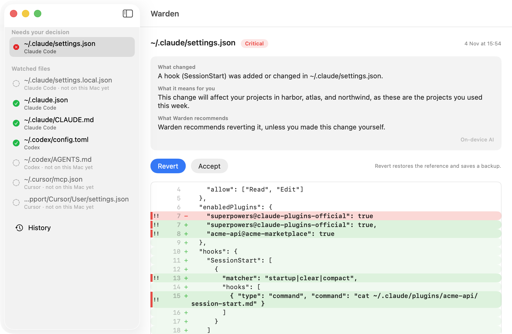
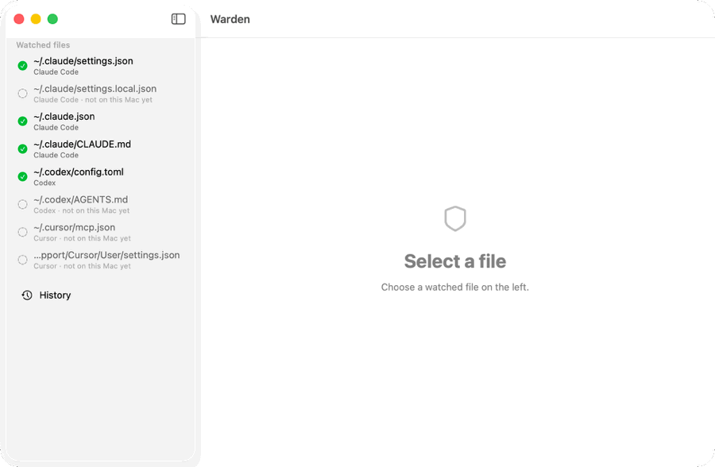

# Warden

[](https://github.com/williamtrde/warden/actions/workflows/ci.yml)
[](LICENSE)

**Know when something quietly changes what your AI coding agents are allowed to do.**

Warden is a native macOS menu bar app that watches the config files of Claude Code, Codex and Cursor. When one of them changes, it tells you what changed, what that means for the projects you actually work on, and lets you accept or revert it. Everything runs on your Mac. Warden has no network code at all.



## Why

Agents act on a handful of small files: hooks that run commands by themselves, MCP servers that receive your data, permissions that skip confirmation. Anything running as you can rewrite them, and nobody reads them.

This is not theoretical. A [public report](https://github.com/postmanlabs/postman-app-support/issues/14370) describes the Postman desktop app installing plugins for Claude Code and Codex on October 24, 2026, with a startup hook that steers agents toward its own skills. Whatever you think of that one case, it shows the gap: a config change that shapes every agent session can land without anyone being asked. A malicious version would look the same, for instance an MCP server URL in `~/.claude.json` quietly pointed at a local proxy.

Warden does not block anything. It makes these changes impossible to miss.

## Install

Download the DMG from the [latest release](https://github.com/williamtrde/warden/releases/latest) and drag Warden to Applications. It is signed and notarized.

Requires macOS 14 or later. Explanations from the on-device model need macOS 26 and Apple Intelligence; without them, Warden uses its built-in rules and works the same way.

## How it works

1. On first launch, Warden keeps a private copy and a SHA-256 of each watched file. That copy is the reference.
2. When a file changes, it compares it with the reference and classifies the change using fixed rules.
3. The shield in the menu bar turns orange for a change, red for a critical one, and a notification offers **Accept** and **Revert**.
4. The main window shows the explanation, the coloured diff and the full history. Any past version can be restored.

Warden never reverts anything by itself. You always decide.



## What triggers an alert

<!-- watch-table:start -->
| File | Agent | What alerts | Revert restores |
|------|-------|-------------|-----------------|
| `~/.claude/settings.json` | Claude Code | Every change | The whole file |
| `~/.claude/settings.local.json` | Claude Code | Every change | The whole file |
| `~/.claude.json` | Claude Code | Security keys only, see below | Those keys only |
| `~/.claude/CLAUDE.md` | Claude Code | Every change | The whole file |
| `~/.codex/config.toml` | Codex | Every change | The whole file |
| `~/.codex/AGENTS.md` | Codex | Every change | The whole file |
| `~/.cursor/mcp.json` | Cursor | Every change | The whole file |
| `~/Library/Application Support/Cursor/User/settings.json` | Cursor | Security keys only, see below | Those keys only |
| Files you add | Any | Every change | The whole file |
<!-- watch-table:end -->

Claude Code and Cursor rewrite two of these files constantly for routine reasons, so only the keys below count there. Everything else stays silent, and Revert leaves it untouched.

<!-- watch-keys:start -->
**`~/.claude.json`**, at top level and inside every `projects.<path>`: `mcpServers`, `mcpContextUris`, `enabledMcpjsonServers`, `disabledMcpjsonServers`, `enableAllProjectMcpServers`, `allowedTools`, `hasTrustDialogAccepted`, `hasClaudeMdExternalIncludesApproved`, `bypassPermissionsModeAccepted`, `skipDangerousModePermissionPrompt`, `customApiKeyResponses`, `env`, `hooks`, `permissions`, `apiKeyHelper`, `otelHeadersHelper`, `enabledPlugins`, `extraKnownMarketplaces`.

**Cursor `settings.json`**: `cursor*`, `aiSettings*`, `chat.*`, `mcp*`, `github.copilot*`, `claudeCode.*`, `http.proxy*`, `security.workspace.trust.*`, `task.allowAutomaticTasks`, `terminal.integrated.env.*`, `terminal.integrated.profiles.*`, `terminal.integrated.defaultProfile.*`, `terminal.integrated.automationProfile.*`, `terminal.integrated.shell*`, `terminal.external.*`.
<!-- watch-keys:end -->

### What counts as critical

**Config files:** hooks, including Codex hook trust hashes; an MCP server added, or its URL, command, args or env changed; sensitive environment variables such as `ANTHROPIC_BASE_URL`, `OPENAI_BASE_URL` and proxies; credential helpers; `enableAllProjectMcpServers`; wider permissions; project trust flags; new plugins or marketplaces; a file Warden cannot parse, since the agent may still read it.

**Instruction files (`CLAUDE.md`, `AGENTS.md`):** these are informational by default. A plain command or URL is highlighted but stays informational. They become critical for hidden or deceptive text, bypass instructions, remote code piped to a shell, reading or sending secrets, and long encoded strings.

## Security model

- **Rules decide, the model only writes.** A changed file is attacker-controlled input. Severity and the recommendation always come from the rules. For critical changes, the statement of what changed does too. The model phrases the rest, and its output is validated and discarded if it fails.
- **No network.** The app is not sandboxed, so no entitlement can prove this. Instead, a test scans the sources and fails on any networking API.
- **Secrets are masked** before they reach the model, and in everything Warden displays.
- **Usage context is metadata only.** To name the projects a change affects, Warden reads project keys, folder names and modification dates. It never reads session content or your code, and a test enforces it.
- **Private storage.** Copies live in `~/Library/Application Support/Warden/` with 0700 and 0600 permissions, because they contain whatever the originals contain.

### Limits

Warden detects, it does not prevent. A change is live until you revert it, and a process running as you can also tamper with Warden's own storage. If Warden's state is damaged, it rebuilds references from its history and tells you. It does not identify which app made a change, and it does not watch per-repository config files.

## Build from source

```sh
brew install xcodegen swiftlint
swift test               # logic suite, never touches your real files
scripts/build-app.sh     # universal Release app, unsigned
scripts/demo.sh          # safe demo against a throwaway fake home
```

See [CONTRIBUTING.md](CONTRIBUTING.md) to add a rule or a watched file.

## License

[MIT](LICENSE)
